# Optimisation of Convergent Electron Gun using ANN

## Final report, EEE F266 Study Project

| | |
|---|---|
| **Students** | Shivansh Shekher Ojha (2023B2A30969H); Satwik Shrivastava (2023B2A80938H) |
| **Supervisor** | Dr. Lalit Kumar |
| **Institution** | Department of Electrical and Electronics Engineering, Birla Institute of Technology and Science (BITS) Pilani, Hyderabad Campus |
| **Course** | EEE F266, Study Project |
| **Date** | November 2026 |
| **Repository** | `EEE/` (GitHub: `Shivansh0911/EEE`, per `docs/context/PROJECT_OURS.md`) |
| **Target venue for the derived abstract and poster** | IVAC 2027 (IEEE International Vacuum Electronics Conference) |

*Note to the typesetter.* Every number in this report comes from a file in the repository, and the file is named next to the number or in the table caption. Figure paths are relative to this file (`docs/ivac2027/`). Please keep the tables as tables.

---

## Abstract

The half-beam cone angle θ fixes the geometry of a convergent Pierce electron gun. It is classically obtained by iterating Vaughan's (1981) synthesis equations. Against 30 published guns, that classical answer is about 10 % from the measured angle (10.49 % for an exact solver, 10.15 % for the published iterative column). This project replaces the angle step with a small artificial neural network (ANN), builds the gun around the predicted angle, and checks every gun in a self-consistent field-and-space-charge simulator: Dr. Lalit Kumar's LKTRON PIERCE (`target.exe`). The simulator is also used in the loop to correct the synthesis.

The network is a 3-3-2-1 tanh perceptron with 23 parameters, written from scratch in NumPy and trained with Levenberg–Marquardt (analytic Jacobian) on the 23 training guns of Panahi et al. (2025), Table 2. On the seven held-out guns it reaches 7.93 % mean relative error (MRE). The median over 30 restarts is 8.33 % (interquartile range 7.14–9.91 %). The 3.74 % published for the same architecture and split could not be reproduced. Adding 1000 synthetic guns made accuracy worse (9.77 %).

The gun is synthesised by Vaughan's equations, solved exactly by a vendored solver written by Vedant, a senior student. The focus electrode is the V = 0 equipotential of Tiwary and Basu's (1988) conformal-map synthesis, which we implemented exactly and validated on the paper's own three guns. In PIERCE, the synthesised guns draw 3 % to 56 % more perveance than designed, and two low-convergence guns fail because the beam strikes the electrodes. A secant search on the anode position, with PIERCE in the loop, brings five guns within 1.3 % of the design perveance in 3–8 runs. Tuning the focus-electrode angle and the anode together brings the 150 kV CEERI klystron gun to −0.7 % current and −1.9 % waist.

New sweeps of anode position (−4 to +6 mm) and cathode radius of curvature (θ ± 8°) show three things. The simulated perveance lies between the planar 1/d² and the Langmuir–Blodgett predictions at every step. The real focus lies 1.6–2.6 times farther from the cathode than the cathode's centre of curvature. A cathode made too flat puts electrons on the gun. A web tool and a one-click local launcher let the supervisor run all of this, including live `target.exe` runs.

---

## Contents

1. Introduction
2. Literature
3. Dataset
4. The ANN
5. Physics of the synthesis
6. Focus-electrode papers
7. Validation gates
8. Simulation in PIERCE (`target.exe`)
9. Optimisation
10. Website and local launcher
11. Demo videos
12. Limitations and negative results
13. Future work
14. Conclusion

References · Acknowledgements · Appendix A (reproduce) · Appendix B (file map) · Appendix C (figure list)

---

## 1 Introduction

### 1.1 Pierce guns

A vacuum electron device (klystron, TWT) needs a well-formed beam. The electron-optical system has three stages: the gun that forms and accelerates the beam, the magnetic focusing system that holds it against space-charge spreading, and the collector (`docs/context/midsem_report.md` §2.1). This project works on the gun only, and only on **pencil beams**: solid, axially symmetric, circular cross-section (`reports/DECISIONS.md` D7).

A Pierce gun is designed around space-charge-limited flow between two concentric spherical surfaces, a cathode and an anode. That flow is the Langmuir–Blodgett (1924) solution. Electrodes outside the beam are shaped so that the field at the beam edge matches the ideal flow. The designer specifies three numbers (`README.md`):

- the perveance P = I / V^1.5 (in µperv, µA V^−1.5),
- the beam waist radius r_w (mm),
- the area convergence C = (r_c / r_w)², where r_c is the cathode disc radius (dimensionless).

### 1.2 Convergent guns and the half-beam cone angle

In a convergent gun the beam leaves a spherical cathode cap and converges to a waist far smaller than the cathode. Once the half-beam cone angle θ is known, the rest of the geometry follows algebraically (`docs/context/midsem_report.md` §2.2):

| Quantity | Relation |
|---|---|
| Cathode disc radius | r_c = √C · r_w = √(I / (π J_c)) |
| Cathode radius of curvature | R_c = r_c / sin θ |
| Anode sphere radius | R_a = R_c e^(−γ), γ = ln(R_c/R_a) |
| Cathode–anode distance | z_ac = R_c − R_a |

θ itself comes from an iterative solution of the spherical space-charge flow together with the anode-aperture lens and the drift to the waist (Vaughan 1981). That makes θ the most consequential single design step.

### 1.3 Why an ANN

The reason is speed inside optimisation, not better accuracy. A multi-objective search with a population of 100 over 500 generations needs 50 000 evaluations of θ (`web/index.html`, Method tab). The exact solver used here takes 3–5 s per design, so 50 000 evaluations would take two to three days (`reports/INTEGRATION_DESIGN.md` §4). A trained network is 23 numbers and three matrix multiplications. Panahi et al. (2025) showed that a network of this size can predict θ from (P, r_w, C). This project:

1. re-implements and benchmarks that network honestly;
2. builds the full gun around its angle, including a focus electrode from Tiwary and Basu (1988);
3. simulates every gun in the supervisor's PIERCE code and uses the simulator in the loop to correct the geometry;
4. puts everything in a static website and a local launcher.

---

## 2 Literature

Each entry gives the full citation as recorded in the repository, and what the project took from it.

| # | Citation | What we took from it | Where used |
|---|---|---|---|
| [1] | R. Panahi, S.A.H. Feghhi, Sh. Sanaye Hajari, M. Khorsandi, "Determination of the Half-Beam cone angle for Pierce electron gun design using an artificial neural network," *Results in Physics* **73** (2025) 108256, doi:10.1016/j.rinp.2025.108256 (open access, CC BY-NC). PDF: `data/raw/panahi2025.pdf`. | The ANN architecture (3 inputs, hidden layers 3 and 2, tanh, LM training); **Table 2 (30 real guns), which is our entire real dataset**; the 23/7 split (asterisked cases); the method comparison (ANN 3.74 %, iterative 10.14 %, non-iterative 27.93 %, modified non-iterative 7.93 % MRE, as printed). | `src/data/build_tier_a.py`, `src/ann/` |
| [2] | J.R.M. Vaughan, "Synthesis of the Pierce gun," *IEEE Trans. Electron Devices* **ED-28**(1) (1981) 37–41. | The full synthesis: Langmuir–Blodgett cone perveance (Eq. 3, constant 14.67), α series (Eq. 5), the angle equations, aberration correction (Sec. III-F, factor 0.905), anode aperture r_a = 1.2 r_b (Eq. 18), anode plane (Eq. 20), throw (Eqs. 12/21). | Vedant's solver `src/physics/vendor/pierce_gun_design_fixed.py`; our emulator `src/physics/closure.py`, `src/physics/lb.py` |
| [3] | U. Tiwary, B.N. Basu, "Noniterative synthesis of convergent Pierce electron guns by the conformal mapping of electrode shapes using logarithmic transformation," *IEEE Trans. Electron Devices* **35**(7) (1988) 1184–1187. PDF (licensed, git-ignored): `data/raw/Noniterative_synthesis_of_convergent_Pierce_electron_guns_by_the_conformal_mapping_of_electrode_shapes_using_logarithmic_transformation.pdf`. | Focus electrode and anode face as the V = 0 and V = V_a equipotentials of the ideal flow, by a logarithmic conformal map. Implemented exactly; Fig. 2 reproduced; the paper's three guns used for validation. | `src/physics/bfe.py`, `demo/paper1_check.py` |
| [4] | U. Tiwary, B. Basu, "Noniterative method for the synthesis of convergent Pierce electron guns," *IEEE Trans. Electron Devices* **34**(5) (1987) 1218–1222. | Original source of 6 of the 30 Table-2 cases (via [1]); the "non-iterative" column of Table 2. Not retrieved directly. | `data/SOURCES.md` |
| [5] | C. Yang, B. Jia, Z. Zhu, "Improved noniterative method for the synthesis of convergent Pierce electron guns," *IEEE Trans. Electron Devices* **53**(11) (2006) 2849–2852. | Source of all 30 Table-2 cases (via [1]); the "modified non-iterative" column. Not retrieved directly. | `data/SOURCES.md` |
| [6] | C. Yang, B. Jia, Z. Zhu (2006), "Improvement in the synthesis method of the Pierce electron gun," *High Power Laser and Particle Beams* **18**(9). | Amendments to Vaughan's iteration (Eqs. 9′, 10′), used in Vedant's solver as a damped cross-check iteration. | header of `src/physics/vendor/pierce_gun_design_fixed.py` |
| [7] | Liao et al. (2003), cited via [6]. | Starting angle θ₀ = 10 √(µP · r_c / r_w). Full citation not in the repository. | Vedant's solver |
| [8] | Greenwood, Zhang, Lau et al., *Phys. Plasmas* **23**, 072101 (2016). | Relativistic diode factor k_f (about −2 % at 150 kV). | Vedant's solver; `src/physics/kf.py`, `models/kf_table.json` |
| [9] | I. Langmuir, K.B. Blodgett, "Currents limited by space charge between concentric spheres," *Phys. Rev.* **24** (1924) 49–59. | Space-charge-limited flow between spheres; full-sphere constant 29.33 µperv, cone constant 14.665 µperv; the α(γ) function. | `src/physics/lb.py` |
| [10] | R. Frost, O. Purl, H. Johnson, "Electron guns for forming solid beams of high perveance and high convergence," *Proc. IRE* **50**(8) (1962) 1800–1807. | Original measurements for cases 1, 2, 9, 12, 25, 29 (via [1]). Not retrieved. | `data/SOURCES.md` |
| [11] | H. Gao, G. Ding, X. Zhou et al., "Numerical study for the effect of angle between inner wall of Wehnelt electrode and its axis on beam dynamics in a thermionic electron gun," *AIP Advances* **15**, 015030 (2025), doi:10.1063/5.0240111, CC BY 4.0. PDF: `data/raw/015030_1_5.0240111.pdf`. | The idea of sweeping the focus-electrode angle and reading current and waist. Repeated here in PIERCE, then automated as tuning. | `src/sim/experiments.py` |
| [12] | J.R. Pierce, *Theory and Design of Electron Beams*, Van Nostrand, 1954. | Background; Pierce's 67.5° electrode angle. | — |
| [13] | D. Nguyen, B. Widrow, "Improving the learning speed of 2-layer neural networks by choosing initial values of the adaptive weights," IJCNN 1990, vol. 3, pp. 21–26. | Weight initialisation for the restarts. | `src/ann/network.py` |
| [14] | Kant & Nagaraju, *IJAMT* **6**(2) (2021), 8 MW S-band CEERI klystron gun. | The 150 kV / 120 A / 9.8 mm / 5 A/cm² reference gun, the gun of the supervisor's reference deck. | `src/export/design_data.py`, `src/sim/experiments.py` |
| [15] | Ardebili et al., *Results in Engineering* (2025), Table 1. | Nine guns used by Vedant to validate his solver (mean deviation 0.26°). | solver header |
| [16] | Shin et al., 35 GHz EIK gun (14 kV, 0.5 A, r_w 0.2255 mm, 5 A/cm²). | Second NSGA-II study. Full citation not in the repository. | `src/moo/studies/shin_eik.json` |
| [17] | R.K. Sharma, A.K. Sinha, S.N. Joshi, "An improved method for the synthesis of anode aperture for Pierce guns," *IEEE Trans. Electron Devices* **48**(2) (2001) 395–397. | **Not implemented** (paywalled). It would replace the empirical 1.2 aperture factor and remove the 56.44° limit. | — |
| [18] | Dr. Lalit Kumar, LKTRON PIERCE (`target.exe`, version 29 Oct 2026), with `pierce_plotter.py` and `new3d.py`. | All simulations. **The supervisor's copyrighted program**: it is called, never modified or redistributed. | `src/sim/lktron.py` |

---

## 3 Dataset

### 3.1 Tier A: 30 real guns (Panahi et al., Table 2)

- **Extraction.** Table 2 was extracted from the PDF programmatically with `pdfplumber`. The raw block is kept verbatim in `src/data/build_tier_a.py` (`TABLE2_RAW`) so it can be diffed against the PDF (D1).
- **Columns.** Case number, P (µperv), r_w (mm), C, θ measured, θ by the paper's ANN, θ iterative, θ non-iterative, θ modified non-iterative.
- **Ranges** (`data/processed/dataset_literature.csv`): P 0.29–3.67 µperv; r_w 0.51–4.42 mm; C 5.12–306.3; θ 9.8°–70.0°.
- **Split.** The seven asterisked cases (3, 6, 12, 15, 17, 26, 29) are test and the other 23 are train. This matches the paper's own statement of 23/7, which independently confirms that the asterisks were read correctly.
- **Provenance.** Cases 1, 2, 9, 12, 25, 29 come from refs [10, 4, 5]; the rest from [5] (quoted from [1]). The rows are counted once, against Panahi et al. (D6).
- **Corrections found.** In the supplied sheet `ANN testing - Sheet1.csv`, case 11 had θ = 37.4 where Table 2 prints 37.04 (D2). The column named "Convergence angle" is in fact the convergence ratio C (D3).
- **Data-fidelity check.** Recomputing the paper's metrics from our extracted `theta_ann_panahi_deg` column gives train MRE 2.1870 %, test 3.7437 %, RMSE 0.959°/2.093°, R 0.997/0.990. This matches the printed values to the digit (`reports/BENCHMARK.md` §2).

### 3.2 Tier B (v1): 1000 synthetic rows from our own physics probe

- Generated by `src/data/synth_generator.py` over C ≥ 8 only, with P 0.30–3.70 µperv, r_w 0.50–4.50 mm, C 8–320 (log-uniform Sobol sampling). Rows with θ outside 9–72° are rejected (`data/SOURCES.md`).
- It was restricted because the probe's closure fails over all 30 guns (MAE 1.66° / MRE 5.75 %) but reaches 0.85° / 2.80 % for C ≥ 8 (§7).
- **It used the full-sphere constant 29.33 where the cone constant 14.665 is correct (D10).** Against the exact solver, the v1 labels are 3.22 % off.
- Training split only, never test. The seven test triples are excluded by construction, and a test refuses any file containing one.
- Superseded by B2 and kept unedited.

### 3.3 Tier B2: 1015 rows labelled by the exact solver

| | |
|---|---|
| Rows | 1015 (1088 Latin-hypercube draws; 73 rejected for θ_raw > 56°, 0 infeasible) |
| Label | θ_T from Vedant's exact solver at V_ref = 1 kV (k_f ≈ 1) |
| Envelope | C 8–306.3 (log-uniform), P 0.30–3.67 µperv, r_w 0.51–4.42 mm, θ_raw ≤ 56°, −α < 7.9 |
| Splits | train 851 / val 164. Never test. |
| File | `data/processed/dataset_synthetic_v2.csv` (`python -m src.data.synth_v2`) |

### 3.4 Tier C: field-solver data

None were generated as training data. The PIERCE runs in §8 are evaluations, not training rows.

### 3.5 Coverage figure

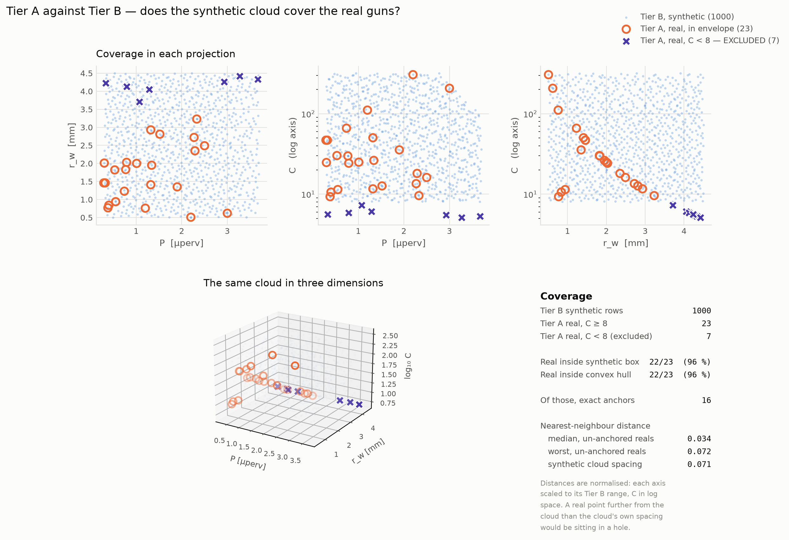

*Figure 3.1. Tier B coverage against the 30 real guns (`reports/figures/tier_overlap.png`). The seven guns with C < 8 (cases 4, 7, 10, 18, 19, 27, 28) are shown as excluded. Case 26 (P = 0.29) lies just below the synthetic P floor.*

---

## 4 The ANN

### 4.1 Architecture and training

| Item | Value | Source |
|---|---|---|
| Network | 3 → 3 → 2 → n_out, tansig in all layers including the output | `src/ann/network.py` |
| Parameters | 23 (n_out = 1, M1); 26 (n_out = 2, M1-multi) | `reports/BENCHMARK.md` §1 |
| Inputs | P, r_w, **ln C** (D8), each min-max scaled to [−1, 1] with training-row limits only | `src/ann/transforms.py`, `src/ann/scaling.py` |
| Optimiser | Levenberg–Marquardt, (JᵀJ + µI)δ = −Jᵀe; µ_init 0.01, ×10 / ÷10 on reject / accept | `src/ann/lm.py`, `reports/m1_run.json` |
| Jacobian | Analytic, one backward pass per residual; agrees with central finite differences to < 1e-6 | `tests/test_jacobian.py` |
| Initialisation | Nguyen–Widrow [13], 10 restarts per training run | `src/ann/network.py` |
| Epoch budget | Set by 5-fold CV inside the 23 training rows; test rows never consulted | `src/ann/train.py` |
| Browser | Same forward pass in JavaScript; agrees with Python to < 1e-9 on 100 random inputs | `tests/test_js_python_parity.py` |
| Satwik's Colab | Our forward pass reproduces his notebook's trained network to 1e-14 | `tests/test_satwik_equivalence.py` |

### 4.2 Models

| Model | Targets | Params | Trained on | Tested on |
|---|---|---|---|---|
| **M1** (headline) | θ | 23 | 23 real guns | 7 real guns |
| M1-multi | θ, R_c (mm) | 26 | same | same |
| M3 | θ | 23 | 23 real + 1000 Tier B v1 | same 7 real guns |
| ANN-E | θ_T (solver) | 113 (3-8-8-1) | 851 Tier B2 rows | judged against the **solver** only |

The selected M1 is seed 101, trained for 5 epochs (the median stopping epoch of its own CV folds) (`reports/BENCHMARK.md` §2). ANN-E's architecture (wide 3-8-8-1 against the paper's 3-3-2-1) was chosen on synthetic validation rows (`reports/synthetic_roles.json`).

### 4.3 Metrics

The metrics are those of the paper's eqs. (8)–(11), in physical units (`src/ann/metrics.py`).

**Table 4.1. Selected models** (`reports/BENCHMARK.md` §2).

| | Train MRE | Test MRE | Train RMSE | Test RMSE | Train R | Test R |
|---|---|---|---|---|---|---|
| Panahi et al. (recomputed) | 2.18 % | **3.74 %** | 0.95° | 2.09° | 0.997 | 0.990 |
| **M1 (θ)** | 6.18 % | **7.93 %** | 2.01° | 3.81° | 0.9906 | 0.9683 |
| M1-multi (θ) | 6.67 % | 8.77 % | 1.85° | 3.26° | 0.9919 | 0.9706 |
| M1-multi (R_c) | 7.73 % | 8.34 % | 1.55 mm | 1.88 mm | 0.9847 | 0.9750 |

M1's out-of-fold CV error on the training rows is 9.75 % (RMSE 3.61°, R 0.9732).

**Table 4.2. Distribution over 30 restarts** (`reports/BENCHMARK.md` §2).

| Model | Median test MRE | IQR | Full range | Restarts below 3.74 % |
|---|---|---|---|---|
| M1 | 8.33 % | 7.14–9.91 % | 2.99–115.75 % | 1 of 30 |
| M1-multi | 9.12 % | 7.18–13.88 % | 5.68–23.94 % | 0 of 30 |

**Table 4.3. M1 and M3 per test gun** (`reports/BENCHMARK.md` §3, §11).

| Case | P (µperv) | r_w (mm) | C | θ measured (°) | θ M1 (°) | M1 error (°) | θ M3 (°) | M3 error (°) |
|---|---|---|---|---|---|---|---|---|
| 3 | 2.50 | 2.49 | 16.13 | 50.28 | 41.21 | −9.07 | 39.24 | −11.04 |
| 6 | 2.27 | 2.72 | 13.52 | 42.16 | 39.50 | −2.66 | 35.88 | −6.28 |
| 12 | 1.20 | 0.76 | 111.00 | 35.70 | 37.94 | +2.24 | 36.76 | +1.06 |
| 15 | 1.01 | 2.00 | 25.00 | 30.00 | 30.08 | +0.08 | 27.15 | −2.85 |
| 17 | 0.74 | 1.23 | 66.10 | 29.04 | 30.36 | +1.32 | 26.78 | −2.26 |
| 26 | 0.29 | 1.46 | 46.91 | 17.00 | 19.12 | +2.12 | 16.72 | −0.28 |
| 29 | 0.40 | 0.84 | 10.61 | 12.70 | 13.67 | +0.97 | 13.93 | +1.23 |

Case 3 is the worst for both M1 and the paper (paper: 45.03° against 50.28°). It is the highest-θ test gun, at the edge where a tanh output compresses.

**Table 4.4. All honest models against the 7 measured test guns** (`reports/INTEGRATION_SUMMARY.md`, `reports/synthetic_roles.json`).

| Model | Test MRE | Bootstrap 90 % | Note |
|---|---|---|---|
| **M1** | **7.93 %** | 4.7–11.4 % | headline |
| M3 (real + synthetic v1) | 9.77 % | — | worse than M1 on 5 of 7 guns |
| ANN-E vs the solver | 0.08 % | — | agreement with a solver, not with reality |
| ANN-E + Stage-2 correction | 5.40 % | 3.0–8.0 % | LOO on 16 training guns: 7.03 % |
| Calibrated closure (solver + ridge on P, ln r_w, ln C) | 2.88 % | 1.3–5.0 % | LOO all 30 guns 5.51 %; **not claimed** (see below) |
| Same, scale-free (P, ln C only; post-hoc) | 7.82 % | — | LOO 23 train 8.35 % |
| Exact solver, uncalibrated | 10.37 % | 7.1–13.4 % | all 30 guns: 10.49 % |
| Paper's iterative column | 10.14 % | — | all 30: 10.15 % |
| Yang 2006 modified non-iterative (paper's column) | 7.93 % | — | — |

The calibrated closure's 2.88 % is not the headline. All of its advantage comes from ln r_w, and θ should not depend on a length scale. The scale-free version is no better than M1 (D11). For "what a measured gun would show", the design tool uses θ_meas ≈ 1.046 × θ_T with a ±13.8 % band (90th percentile of LOO error on the 23 training guns).

### 4.4 Ablations

| Change | Effect (median test MRE, 30 restarts, fixed 200 epochs) | Source |
|---|---|---|
| Linear C → ln C, n_out = 1 | 13.36 % → 9.87 % | `BENCHMARK.md` §8 |
| Linear C → ln C, n_out = 2 | 18.89 % → 7.78 % | same |
| Residual weights θ/R_c = 1/1, 4/1, 1/4, 1/0 | 7.78 %, 9.06 %, 19.08 %, 8.42 % | §6 |

Under linear C, 25 of the 30 rows fall in the bottom 15 % of the input range (D8). Test case 12 moved from +30.2° error to +2.24° under ln C. The ln C choice was made after the improvement had been seen. This is stated in D8 and is not a blind pre-registration.

### 4.5 What was not reproducible

- **3.74 %.** Same data (verified to the digit), same split, same architecture and same optimiser give a median of 8.33 %. Only 1 restart in 30 falls below 3.74 %. The CV score ranks restarts only weakly (Spearman +0.498 for M1). The paper reports no seed, restart count, selection rule or variance, so the cause cannot be identified. The gap may come from a method detail that the paper does not record (`BENCHMARK.md` §4).
- **Two earlier findings were withdrawn** after D8: "the second output costs θ accuracy" and "down-weighting R_c improves θ" (`BENCHMARK.md` §0).
- **R_c as the second output carries no independent information.** It is √C · r_w / sin θ, a deterministic function of the inputs and θ (D3).

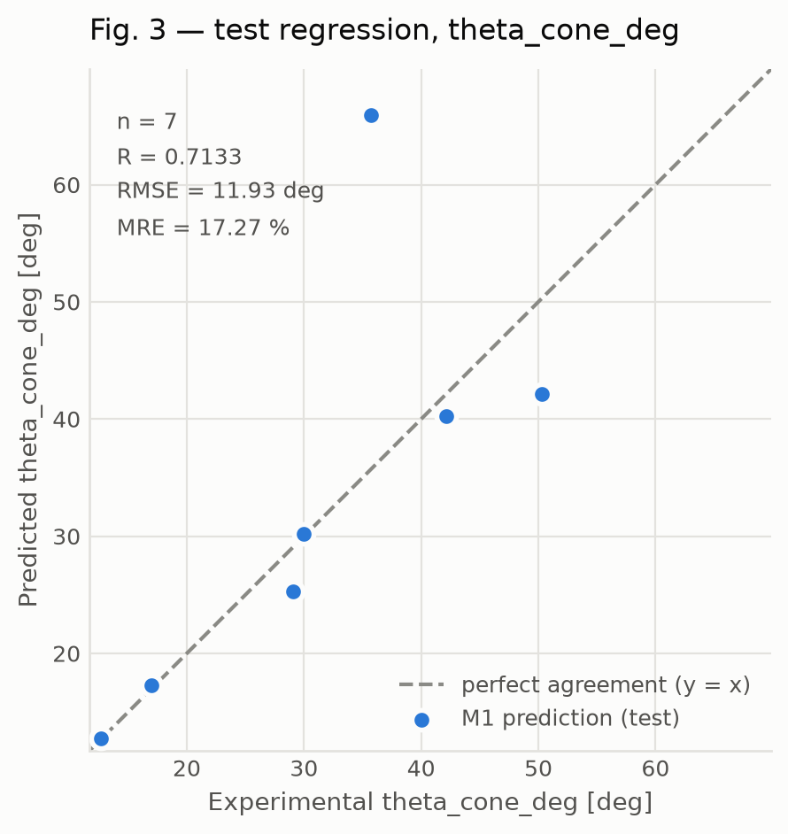

*Figure 4.1. M1 regression on the 7 test guns (`fig3_regression_test.png`). The training-set counterpart is `fig3_regression_train.png`.*

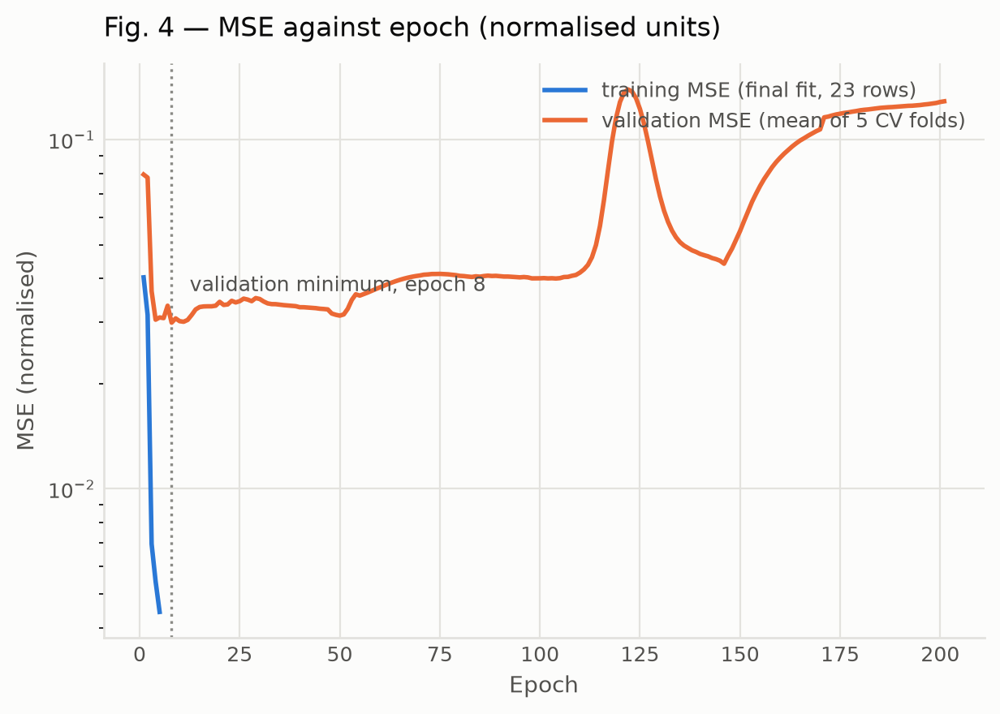

*Figure 4.2. Training and cross-validation MSE against epochs (`fig4_mse_vs_epochs.png`). The CV curve bottoms early, which is why M1 stops at 5 epochs.*

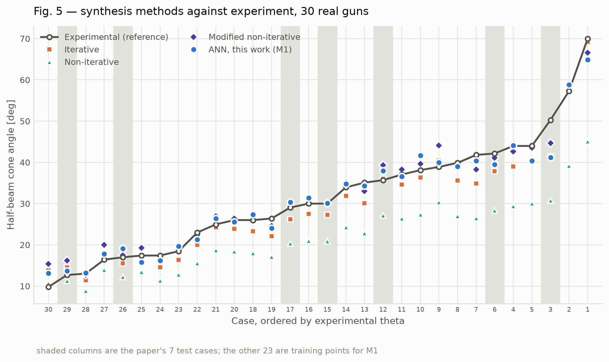

*Figure 4.3. θ by the ANN and the three classical methods against measurement (`fig5_method_comparison.png`).*

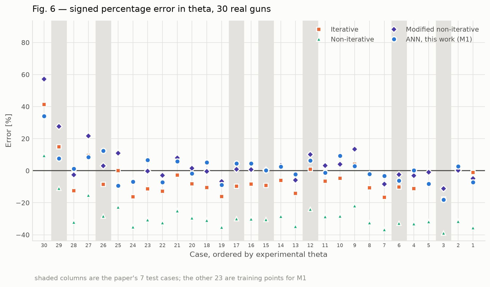

*Figure 4.4. Percentage error per gun and method (`fig6_percentage_error.png`).*

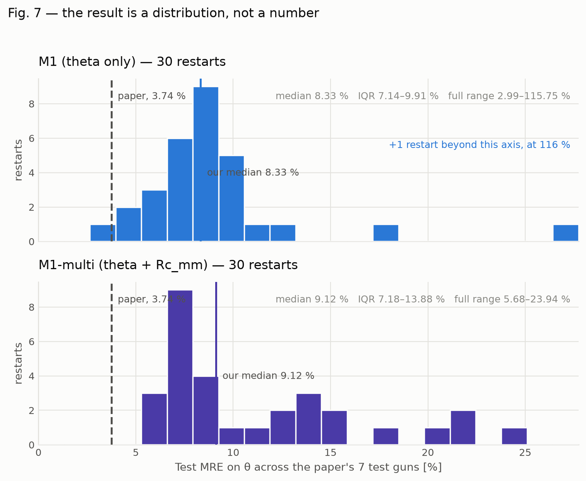

*Figure 4.5. Test MRE over 30 restarts (`fig7_restart_histogram.png`); the paper's single value is marked.*

---

## 5 Physics of the synthesis

### 5.1 Langmuir–Blodgett spherical flow

- Langmuir and Blodgett [9] give the current between full concentric spheres as I = (16π/9) ε₀ √(2e/m) V^1.5 / α², i.e. a full-sphere microperveance constant of **29.33**.
- A Pierce gun uses only the cone of half-angle θ, which subtends (1 − cos θ)/2 of the sphere. The constant is therefore halved: **µP = 14.665 · k_f · (1 − cos θ) / α²(γ)**, γ = ln(R_c/R_a). Vaughan's Eq. 3 prints 14.67 (`src/physics/lb.py`).
- α(γ) is Vaughan's Eq. 5 series. The probe also integrates the ODE 3αα″ + α′² + 3αα′ = 1, α(0) = 0, α′(0) = 1 (derived from Poisson's equation), which reproduces the classical series α = γ + 0.3γ² + 0.075γ³ + 0.0143182γ⁴ + … to about 1e-9 (`reports/VALIDATION_table2.md`, Result 1).
- Space-charge spread constant: 0.174090 (Vaughan 0.17409), derived from CODATA.
- **Finding (D10).** Our early probe used 29.33 with (1 − cos θ), a factor of two too large. A fitted lens coefficient of 0.62 (Vaughan: 0.417) partly absorbed the error.

### 5.2 Vaughan's synthesis, solved exactly

**Attribution.** The exact solver is **Vedant's work** from the previous semester: `src/physics/vendor/pierce_gun_design_fixed.py`, 1561 lines, vendored **unmodified** with his permission (`data/SOURCES.md`). This repository imports it through `src/physics/vaughan_adapter.py` (units and the replacement of its interactive prompts) and never edits it. It implements Vaughan (1981) with the Yang–Jia–Zhu amendments [6], the Liao starting angle [7], the Greenwood relativistic factor [8], a 67.5° focus-electrode construction and an EGUN point-deck writer. His recorded validations are the CEERI klystron gun of Kant & Nagaraju (2021), within 0.51 % (before the relativistic factor was added), and nine guns of Ardebili et al. (2025) at a mean deviation of 0.26°.

The main steps (solver header and `reports/INTEGRATION_DESIGN.md`):

| Step | Content |
|---|---|
| Inputs | V, I, r_w, J_c (equivalently P, r_w, C at a reference V) |
| Angle | θ (raw) from the Region-I / Region-II equations by bracketed bisection; Yang's damped iteration as an independent cross-check (warns if they differ > 0.1°) |
| Relativistic factor | k_f (Greenwood 2016): about −0.2 % at 14 kV, −2 % at 150 kV, −6 % at 500 kV; **k_f = 0.979 for the CEERI gun** (`docs/context/VEDANT_WORK.md`, `INTEGRATION_SUMMARY.md`) |
| Aberration correction | sin θ_raw = 0.905 sin θ_T (Sec. III-F). The cathode is **built** with R_cT = r_c / sin θ_T = 0.905 R_c |
| Anode aperture | r_a = 1.2 r_b(z_a) (Eq. 18). Above θ_raw = 56.44°, Eq. 20 for z_a has no real root; such designs are flagged (`za_valid = False`) and refused for decks |
| Throw | z_w, cathode vertex to waist (Eqs. 12/21) |
| Feasibility | `GunInfeasible` for impossible inputs (r_c ≤ r_w, α outside series validity) |

**θ_raw and θ_T are never mixed** (`INTEGRATION_DESIGN.md` §2). R_c, R_a, z_ac, z_a, throw and aperture follow from θ_raw. The built cathode uses θ_T. Table 2's angles and the ANN target are θ_T.

**Emulator.** `src/physics/closure.py` (`LBClosure`) re-implements his algorithm in vectorised float64 (same window, scan and root choice). It matches his solver to about 1e-8 (Gate G1) and evaluates 100 designs in about 0.3 s, against 3–5 s per design for the exact solver.

**Defects found in the vendored solver (reported to him, not fixed)** (`INTEGRATION_DESIGN.md` §5):

1. The Eq. 5 inversion stops converging at −α ≈ 7.94 (R_c/R_a ≈ 15) because Newton is capped at 20 iterations. Synthetic data and the optimiser stay below −α = 7.9.
2. "Within 0.51 %" on the CEERI gun predates the relativistic factor. With k_f = 0.979 the final code gives θ = 28.797° against the published 28.5652° (0.81 %), and z_ac 29.79 mm against 30.1 mm (1.0 %).
3. The measured run time is 3–5 s per design, not the 1.8 s noted in the code.
4. His point-deck writer never closes the `&CATHODE` namelist with `/` (§8.2).

### 5.3 Our gun

"Our gun" is what the website computes (`src/sim/ourgun.py`):

- inputs P, r_w, C;
- θ from M1;
- the gun synthesised around θ by Vaughan's equations (geometry from Vedant's exact synthesis via `geometry_from_theta`, which reproduces his geometry to 1e-14 when given his angle);
- cathode built aberration-corrected; anode face and aperture 1.2 r_b; drift tube;
- focus electrode from Tiwary & Basu (V = 0 equipotential, leaving the cathode at 67.5° to the beam edge), followed up to 1.5 × the cathode radius or its highest point, then joined to the outer wall.

A gun made of Tiwary–Basu curves alone (both electrodes cut at their highest point) failed in PIERCE on 2 of 7 guns. The combined construction runs on all of them (`ourgun.py` docstring).

---

## 6 Focus-electrode papers

### 6.1 Tiwary & Basu (1988): implementation

**Method** (`src/physics/bfe.py`). Inside the beam, the potential is Langmuir and Blodgett's, V ∝ α(γ)^(4/3). The logarithmic map w = ln z sends the cathode, anode and beam edge to straight lines. Outside the beam, V = Re{C α(−s)^(4/3)} with s = ln(ρ/R_c) + j(θ − θ₀). The V = 0 curve is the focus electrode (BFE) and the V = V_a curve is the anode face.

**Our implementation.** The paper finds the equipotentials by Newton forward interpolation along radial lines. We trace them **exactly** by inverting the α series in the complex plane:

- BFE: α(−s) = t e^(−j3π/8);
- anode: α(−s) = (K + jτ)^(3/4), K = α(y)^(4/3).

This makes the BFE leave the cathode rim at exactly 3π/8 = 67.5°, Pierce's angle. It also shows that the BFE shape in the (ln ρ/R_c, θ − θ₀) plane is the same for every gun. Vedant's straight 67.5° electrode is the first-order tangent of this curve.

**Validation on the paper's own three guns** (computed with the code of `demo/paper1_check.py`; lengths in mm as in the paper's Fig. 2):

| Gun | r_c/r_a | r_c (mm) | θ₀ (°) | BFE angle at rim (°) | R_a exact (mm) | Our anode curve at beam edge (mm) | Paper's R_a (mm) | Paper's error | Dropped axisymmetric terms (rms) |
|---|---|---|---|---|---|---|---|---|---|
| Litton L-2087 | 1.985 | 13.665 | 13.44 | 67.497 | 6.8841 | 6.8841 | 6.867 | 0.25 % | 63 % |
| Varian VTC 6364 | 2.389 | 10.158 | 15.59 | 67.497 | 4.2520 | 4.2520 | 4.235 | 0.40 % | 62 % |
| Frost and Purl | 2.393 | 17.567 | 27.17 | 67.497 | 7.3410 | 7.3410 | 7.311 | 0.41 % | 53 % |

Other checks (`tests/test_bfe.py`): the curves are equipotentials to < 1e-9; the BFE is the same curve for every gun; the potential is 2-D harmonic in (ln ρ, θ) to < 1e-4.

**What the method gets wrong.** The map is conformal in the plane, but a gun is axisymmetric. The axisymmetric Laplacian keeps the terms V_u + cot θ · V_θ, which the map drops. They are 53–63 % (rms) of the terms that cancel (`laplace_residual`; `reports/SIMULATION.md` §4 quotes 50–80 %). The paper reports residues under 0.5 %, by a measure it does not define.

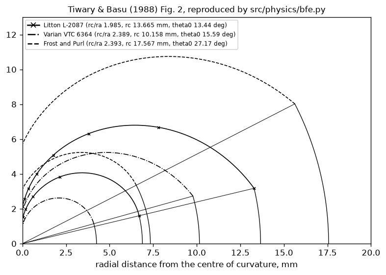

*Figure 6.1. Fig. 2 of Tiwary & Basu (1988) recomputed by `src/physics/bfe.py` for the paper's three guns (`tiwary_basu_fig2.png`). Laid over the scanned figure (kept local, licensed), the cathode arcs and beam edges coincide. The curves match near the beam and drift apart far from it, where the paper says its interpolation is least accurate.*

**In PIERCE (CEERI gun, Vedant-style deck with Tiwary–Basu electrodes):** −14.5 % current, no interception, waist −33.6 % (`reports/SIMULATION_RESULTS.md`). That is no better a first guess than Vedant's straight line (+26.5 %), so it is offered as an option in the Design tab, not as the default (D14). In "our gun" (§5.3, a different construction) the Tiwary–Basu focus electrode gives +3.0 % on the same gun (§8.5).

### 6.2 Gao et al. (2025): electrode angle

Gao et al. ran a COMSOL study of a 60 kV welding gun. They swept the angle of the Wehnelt electrode's inner wall and read off current, waist and emittance. They cite 67.5° for space-charge-limited guns and found 60° best for their temperature-limited gun. Their angle is measured from the axis. Vedant's ψ is measured from the beam edge, so theirs = ψ − θ_T (`reports/SIMULATION.md` §5). We ran the same sweep on the CEERI gun in PIERCE (§8.4) and added the step the paper does not take: tuning the angle automatically until the simulated gun meets its specification (§9.2).

---

## 7 Validation gates

| Gate | Criterion | Result | Source |
|---|---|---|---|
| Physics gate, strict | Our probe reproduces Table 2's iterative column to MAE ≤ 0.5° or MRE ≤ 1.5 %, all 30 guns | **FAILED**: 1.66° / 5.75 % at the best lens coefficient c = 0.62. Asserted failing by `test_strict_gate_over_all_30_cases_still_fails` | `reports/VALIDATION_table2.md` |
| Physics gate, restricted (C ≥ 8) | MAE ≤ 1.0° and MRE ≤ 3.0 % | PASS: 0.85° / 2.80 % (LOO refit of c: 0.92° / 2.89 %) | same, addendum |
| Residual structure | — | R(error, ln C) = +0.794; mean error −4.29° for C < 8 against −0.35° for C ≥ 8 | same |
| **G1** | Emulator vs Vedant's solver, ≥ 80 random designs; θ mean rel. error ≤ 0.05 %, lengths ≤ 0.1 %, identical feasibility | **PASS**: 100 designs; θ_T mean 7.0e-9, lengths 7.6e-9, max 3.9e-8; 0 disagreements; emulator 0.30 s, exact solver 31.6 s (parallel) | `reports/gates/G1.json` |
| **G2** | No synthetic row in a test split; all synthetic rows feasible | **PASS**: train/val only; 1015/1015 feasible (emulator); 24/24 sampled identical (exact) | `tests/test_synthetic_v2.py` |
| **G3** | ≥ 10 Pareto designs per study, knee included, re-run exactly; fail if infeasible or > 2 % off | **PASS**: 13 per study; worst rel. error 5.3e-8 (Shin), 7.0e-8 (CEERI) | `reports/moo/*/verify.csv` |
| Jacobian | Analytic vs central finite differences | < 1e-6 | `tests/test_jacobian.py` |
| JS/Python parity | 100 random inputs, under Node | < 1e-9 | `tests/test_js_python_parity.py` |
| PIERCE deck JS/Python | Design-tab deck identical to the Python deck | pass | `tests/test_pierce_js_parity.py` |
| PIERCE driver | Supervisor's reference deck re-run through our driver | 121.7416 A, throw 85.5 mm, waist 7.4336 mm (exactly as his own run) | `tests/test_lktron.py` |

---

## 8 Simulation in PIERCE (`target.exe`)

### 8.1 What `target.exe` is

`simulation/lktron/target.exe` is **LKTRON PIERCE**, Dr. Lalit Kumar's gun code (banner "@Copyright Dr. LALIT KUMAR", version 29 Oct 2026). It reads `pierce.in` and solves Poisson's equation on an axisymmetric grid. It launches Child-law trajectories from the cathode and iterates to self-consistency. It writes `pierce.log` (current, perveance, envelope, throw, waist, interception), `pierce.plt` (electrodes, trajectories, equipotentials) and `pierce.3D` (field maps). His `pierce_plotter.py` and `new3d.py` draw them. Its input format is the point deck that Vedant's synthesis writes. The binary is the supervisor's: it is git-ignored, and it is only called, never modified or redistributed (`reports/SIMULATION.md` §1; `README_FOR_SIR.md`).

### 8.2 The driver and the deck fixes we found

The driver is `src/sim/lktron.py`. Running our decks exposed three problems (`reports/SIMULATION.md` §2):

| Problem | Symptom in PIERCE | Fix |
|---|---|---|
| Vedant's `print_gun_points` never closes `&CATHODE` with `/` | `Fortran runtime error: End of file` | our deck writer adds it; `tests/test_lktron.py` records his omission |
| Vedant's `&CONTROL/&PRINTS/&PLOT` values | crash re-reading its own `pierce.plt` ("Bad value during integer read") | use the values from the supervisor's reference deck |
| At most 500 mesh intervals along z | `FATAL ERROR : THE PROBLEM SIZE EXCEEDS THE LIMIT` | grid chosen from the cathode radius and coarsened to fit |

Two choices are ours:

- The drift tube runs to 2 × the designed throw, because Vedant's 1.3 × ends the domain before PIERCE's waist.
- Trajectory losses are split into "lost in gun" (ending before the waist, a gun defect) and "after the waist" (the expanding beam scraping the tube, which a focusing magnet prevents in a real device).

Throw and waist are refined by a parabola through the envelope minimum, because PIERCE samples the envelope every 6 mm.

### 8.3 Reference reproduction

Re-running the supervisor's own CEERI deck through the driver gives **121.7416 A**, throw 85.5 mm and waist 7.4336 mm, the same as his run (`tests/test_lktron.py`; `reports/simulation/summary.json`, variant `reference`). On the parabola-refined measure it is 121.74 A (+1.5 % vs 120 A), throw 88.0 mm, waist 7.41 mm (`reports/SIMULATION_RESULTS.md`).

### 8.4 All variants on the CEERI gun

The gun is 150 kV, 120 A, waist 9.8 mm, 5 A/cm². The design is µP 2.0656, θ_T 32.16°, θ_raw 28.80°, R_c 57.38 mm, R_cT 51.93 mm, R_a 27.59 mm, z_ac 29.79 mm, throw 77.81 mm. The grid is 0.5 mm (`reports/simulation/summary.json`).

**Table 8.1. CEERI variants in PIERCE** (`reports/SIMULATION_RESULTS.md`).

| Variant | Current (A) | vs 120 A | Lost in gun | Throw (mm) | vs design | Waist (mm) | vs 9.8 mm | Run (s) |
|---|---|---|---|---|---|---|---|---|
| Supervisor's reference deck | 121.74 | +1.5 % | 0/57 | 88.0 | +13.1 % | 7.41 | −24.4 % | 38 |
| Our ANN M1 angle (32.17°), Vedant's construction | 151.87 | +26.6 % | 1/58 | 83.9 | +7.8 % | 12.07 | +23.2 % | 41 |
| ANN-E angle (31.90°) | 146.06 | +21.7 % | 0/58 | 87.5 | +12.5 % | 11.93 | +21.8 % | 41 |
| Vedant's deck as built (32.16°, ψ 67.5°, R_cT) | 151.79 | +26.5 % | 1/58 | 84.0 | +8.0 % | 12.06 | +23.0 % | 48 |
| Vedant's construction, uncorrected R_c | 168.48 | +40.4 % | 19/57 | 125.3 | +61.1 % | 12.22 | +24.7 % | 46 |
| Tiwary–Basu electrodes | 102.62 | −14.5 % | 0/57 | 100.7 | +29.5 % | 6.51 | −33.6 % | 42 |
| ψ 57.5° | 121.23 | +1.0 % | 0/58 | 96.2 | +23.7 % | 6.55 | −33.2 % | 43 |
| ψ 62.5° | 136.04 | +13.4 % | 0/58 | 98.4 | +26.4 % | 9.50 | −3.1 % | 44 |
| ψ 72.5° | 166.09 | +38.4 % | 32/58 | no waist | — | no waist | — | 46 |
| ψ tuned (57.08°) | 120.19 | **+0.2 %** | 0/58 | 94.9 | +22.0 % | 6.40 | −34.7 % | 58 |
| ψ 65.66° + anode +2.27 mm (tuned) | 119.14 | **−0.7 %** | 0/58 | 99.8 | +28.3 % | 9.61 | **−1.9 %** | 38 |

Interpretation (`reports/SIMULATION.md` §3):

- Whichever code supplies the angle, the 67.5° straight-electrode gun draws 22–27 % too much current. The error is in the electrode construction, not the angle. M1's angle is within 0.03 % of Vedant's for this gun.
- The current rises smoothly with ψ: 121 → 136 → 152 → 166 A from 57.5° to 72.5°. Pierce's 67.5° is a planar-diode result.
- The aberration-corrected cathode R_cT is the right one to build. With the uncorrected R_c, 19 trajectories hit the gun.
- Vaughan's throw is optimistic in every run, the supervisor's deck included (+8 % to +61 %; +13 % for the reference deck). Neither knob fixes it.
- In the 2-D-tuned run, 15 of 58 trajectories end on the drift tube after the waist, and PIERCE reports 62.9 A intercepted there (transmission 47.2 % in `reports/simulation/tuned_2d.json`). By the convention of §8.2 this is not counted against the gun, but a reader should know it.

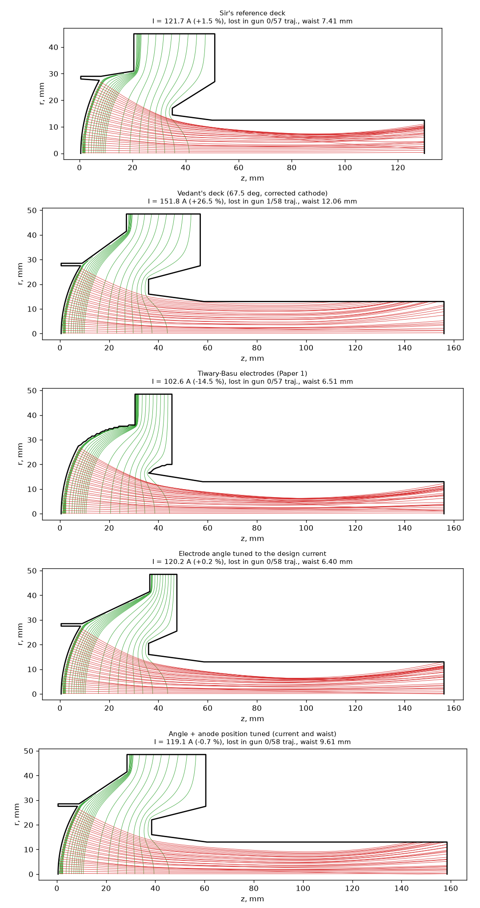

*Figure 8.1. PIERCE trajectories (red) and equipotentials (green) for the CEERI gun (`sim_trajectories.png`). From top: the supervisor's reference deck (121.7 A, +1.5 %); Vedant's deck (151.8 A, +26.5 %); Tiwary–Basu electrodes (102.6 A, −14.5 %); ψ tuned to the current (120.2 A, +0.2 %); ψ and anode tuned (119.1 A, −0.7 %, waist 9.61 mm).*

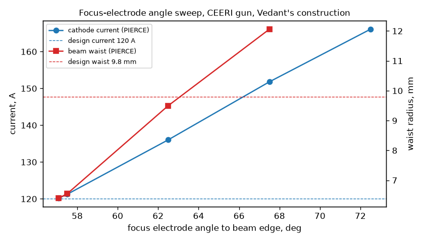

*Figure 8.2. Focus-electrode angle sweep, CEERI gun, Vedant's construction (`sim_psi_sweep.png`): cathode current and waist against ψ, with design lines at 120 A and 9.8 mm.*

### 8.5 Our gun on 8 guns

The 8 guns are the CEERI reference gun at 150 kV and the seven held-out guns of Table 2 at V = 10 kV. They are run in PIERCE untuned (`python -m src.sim.ourgun`; `reports/simulation/ourgun/summary.json`, `guns`).

**Table 8.2. Our gun in PIERCE, untuned.**

| Gun | θ measured (°) | θ ANN (°) | Grid (mm) | µP design | µP PIERCE | Perveance error | Current design → PIERCE | Waist design → PIERCE (mm) | Throw design → PIERCE (mm) | Lost in gun | Lost after waist |
|---|---|---|---|---|---|---|---|---|---|---|---|
| CEERI (150 kV) | — | 32.17 | 0.5 | 2.0656 | 2.128 | +3.0 % | 120.00 → 123.65 A | 9.8 → 6.64 (−32.2 %) | 77.8 → 98.6 | 0/58 | 1 |
| Case 3 | 50.28 | 41.21 | 0.2 | 2.50 | 2.702 | +8.1 % | 2.500 → 2.702 A | 2.49 → 0.83 (−66.6 %) | 26.2 → 32.8 | 0/54 | 3 |
| Case 6 | 42.16 | 39.50 | 0.2 | 2.27 | 2.507 | +10.4 % | 2.270 → 2.508 A | 2.72 → 0.45 (−83.3 %) | 26.7 → 39.7 | 0/54 | 0 |
| Case 12 | 35.70 | 37.94 | 0.2 | 1.20 | 1.870 | +55.8 % | 1.200 → 1.870 A | 0.76 → 0.32 (−57.9 %) | 24.8 → 25.9 | 0/43 | 28 |
| Case 15 | 30.00 | 30.08 | 0.2 | 1.01 | 1.275 | +26.2 % | 1.010 → 1.275 A | 2.00 → 0.47 (−76.3 %) | 37.7 → 37.8 | 0/52 | 40 |
| Case 17 | 29.04 | 30.36 | 0.2 | 0.74 | 1.139 | +53.9 % | 0.740 → 1.139 A | 1.23 → 0.32 (−74.2 %) | 39.4 → 36.6 | 0/52 | 45 |
| Case 26 | 17.00 | 19.12 | 0.5 | 0.29 | 0.067 | −76.9 % | 0.290 → 0.067 A | no waist | — | **19/20** (hits at z = 23.0–31.6 mm) | 0 |
| Case 29 | 12.70 | 13.67 | 0.1 | 0.40 | 0.532 | +32.9 % | 0.400 → 0.532 A | no waist | — | **26/27** (hits at z = 6.9–25.2 mm) | 0 |

- **Six guns run cleanly** and draw +3 % (CEERI) to +56 % (case 12) more than their design perveance.
- **Cases 26 and 29 fail.** These are the two lowest-θ guns (17.0°, 12.7° measured). Nearly every electron hits the gun, and PIERCE does not converge.
- **Every simulated waist is smaller than designed**, by 32 % to 83 %.
- The throw agrees for case 15 but is +27 % for the CEERI gun.

### 8.6 Anode tuning with PIERCE in the loop

`tune_anode` in `src/sim/ourgun.py` runs a secant search on the anode axial shift (face, aperture and drift tube moved together) until PIERCE's perveance equals the input P. The tolerance is 1 %. The first step is 0.1 × throw/2, signed so that too much current moves the anode away. Only guns with no electrons lost in the gun are tuned (`reports/simulation/ourgun/summary.json`, `tuned`).

**Table 8.3. Anode-tuned guns.**

| Gun | Anode shift (mm) | PIERCE runs (incl. untuned) | Perveance error | Current (A) | Waist (mm), vs design | Throw (mm), design | Lost in gun |
|---|---|---|---|---|---|---|---|
| CEERI | +0.037 | 8 | −1.29 % | 118.46 | 6.25 (−36.3 %) | 99.4 (77.8) | 0/58 |
| Case 6 | +0.544 | 3 | +0.13 % | 2.273 | 0.34 (−87.5 %) | 37.3 (26.7) | 0/54 |
| Case 12 | +1.942 | 4 | −0.42 % | 1.195 | 0.24 (−69.0 %) | 24.1 (24.8) | 0/43 |
| Case 15 | +1.098 | 4 | +0.20 % | 1.0125 | 0.32 (−84.1 %) | 34.9 (37.7) | 0/52 |
| Case 17 | +2.760 | 5 | +0.66 % | 0.7449 | 0.26 (−78.7 %) | 33.7 (39.4) | 0/52 |

- **Five guns are within 1.3 % of the design perveance in 3–8 PIERCE runs.**
- The CEERI search shows the grid's resolution. Shifts of +0.037, +0.075 and +0.208 mm all give −1.29 %, and −0.052 mm gives the untuned +3.02 %. On a 0.5 mm grid, sub-cell shifts do not move any electrode point, so the secant search cannot do better than one grid step allows.
- **Case 3 is missing from the tuning record** in `summary.json`. Its run folders exist: `case3_tune_dz+1.310` (−19.84 %) and `case3_tune_dz+0.379` (−1.48 %, 0 lost in gun). This is just outside the 1 % tolerance, and no further step is recorded. To be re-run before it is quoted.
- Matching the current with the anode leaves the waist 36–88 % below design. One knob cannot set two targets (compare §8.7 and §9.2).

### 8.7 New sweeps: anode shift and cathode radius of curvature

`src/sim/sweeps.py` runs 19 PIERCE simulations per gun: 10 anode shifts and 9 beam angles. Data: `reports/simulation/sweeps/sir_gun.json`, `case15.json`. Each run's deck, log and plot data are under `reports/simulation/sweeps/<gun>/`.

- **Anode shift.** The anode (face, aperture, drift tube) is moved along the axis by −4…+6 mm, with everything else kept. The cathode–anode spacing d changes. Two predictions are made from the unshifted gun's simulated perveance P₀:
  - the planar Child-law scaling P = P₀ (d₀/d)²;
  - Langmuir–Blodgett for the spherical diode, P = P₀ (α₀/α)², with α from Vaughan's Eq. 5 at y = ln(R_c / (R_a − shift)).
- **Cathode R_c.** The cathode disc r_c and the perveance are kept. The beam angle is changed by −8…+8° around the network's angle, so R_cT = r_c / sin θ_T changes. The anode is re-placed by Langmuir–Blodgett for the same perveance, and the Tiwary–Basu electrode follows. The cathode's **aim point** is its centre of curvature, R_cT from the vertex: the point where electrons would meet with no space charge.

#### 8.7.1 CEERI gun (150 kV, design P 2.0656 µperv, r_w 9.8 mm, C 7.9544; network angle 32.17°)

**Table 8.4. Anode sweep, CEERI gun** (R_c 57.36 mm, R_a 27.58 mm, r_c 27.64 mm).

| Shift (mm) | d (mm) | µP PIERCE | Current (A) | vs design | µP 1/d² | µP L-B | Focus from cathode (mm) | Waist (mm) | Lost in gun |
|---|---|---|---|---|---|---|---|---|---|
| −4 | 25.79 | 3.106 | 180.44 | +50.4 % | 2.839 | 3.513 | 89.9 | 10.35 | 0/58 |
| −3 | 26.79 | 2.814 | 163.50 | +36.2 % | 2.631 | 3.095 | 93.2 | 9.36 | 0/58 |
| −2 | 27.79 | 2.557 | 148.53 | +23.8 % | 2.445 | 2.730 | 96.1 | 8.40 | 0/58 |
| −1 | 28.79 | 2.329 | 135.31 | +12.8 % | 2.278 | 2.409 | 97.5 | 7.48 | 0/58 |
| 0 | 29.79 | 2.128 | 123.65 | +3.0 % | 2.128 | 2.128 | 98.6 | 6.64 | 0/58 |
| +1 | 30.79 | 1.951 | 113.36 | −5.5 % | 1.992 | 1.880 | 100.1 | 5.88 | 0/58 |
| +2 | 31.79 | 1.794 | 104.20 | −13.1 % | 1.869 | 1.661 | 102.2 | 5.16 | 0/58 |
| +3 | 32.79 | 1.653 | 96.05 | −20.0 % | 1.756 | 1.466 | 112.3 | 4.41 | 0/58 |
| +4 | 33.79 | 1.528 | 88.78 | −26.0 % | 1.654 | 1.294 | 126.5 | 3.53 | 0/58 |
| +6 | 35.79 | 1.313 | 76.27 | −36.4 % | 1.474 | 1.004 | 133.9 | 1.90 | 0/58 |

**Table 8.5. Cathode R_c sweep, CEERI gun** (r_c 27.64 mm; anode re-placed by L-B).

| Δθ (°) | θ_T (°) | R_cT = aim point (mm) | R_c (mm) | R_a (mm) | d (mm) | Focus (mm) | Focus / aim | Waist (mm) | µP PIERCE | Current (A) | vs design | Lost in gun (where, mm) |
|---|---|---|---|---|---|---|---|---|---|---|---|---|
| −8 | 24.2 | 67.5 | 74.59 | 41.59 | 33.01 | none | — | none | 1.942 | 112.84 | −6.0 % | **38/56** (66.2…) |
| −6 | 26.2 | 62.7 | 69.25 | 37.14 | 32.11 | 101.3 | 1.62 | 10.86 | 1.982 | 115.16 | −4.0 % | 0/57 |
| −4 | 28.2 | 58.5 | 64.69 | 33.41 | 31.28 | 106.6 | 1.82 | 9.38 | 2.027 | 117.77 | −1.9 % | 0/57 |
| −2 | 30.2 | 55.0 | 60.77 | 30.27 | 30.51 | 104.2 | 1.89 | 8.10 | 2.024 | 117.60 | −2.0 % | 0/57 |
| 0 | 32.2 | 51.9 | 57.36 | 27.58 | 29.79 | 98.6 | 1.90 | 6.64 | 2.128 | 123.65 | +3.0 % | 0/58 |
| +2 | 34.2 | 49.2 | 54.38 | 25.26 | 29.11 | 101.2 | 2.06 | 6.00 | 2.097 | 121.80 | +1.5 % | 0/58 |
| +4 | 36.2 | 46.8 | 51.75 | 23.26 | 28.49 | 95.8 | 2.05 | 5.05 | 2.229 | 129.51 | +7.9 % | 0/59 |
| +6 | 38.2 | 44.7 | 49.42 | 21.51 | 27.91 | 105.4 | 2.36 | 4.51 | 2.301 | 133.67 | +11.4 % | 0/59 |
| +8 | 40.2 | 42.8 | 47.35 | 19.98 | 27.37 | 113.1 | 2.64 | 3.77 | 2.424 | 140.83 | +17.4 % | 0/60 |

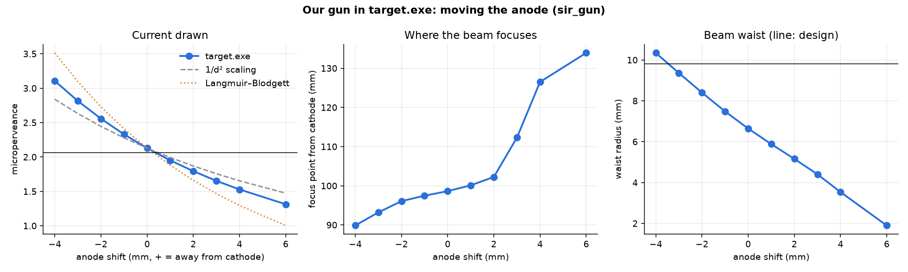

*Figure 8.3. CEERI gun in PIERCE, anode shift (`sweep_anode_sir_gun.png`): microperveance with the 1/d² and Langmuir–Blodgett predictions, focus point, and waist (line: design).*

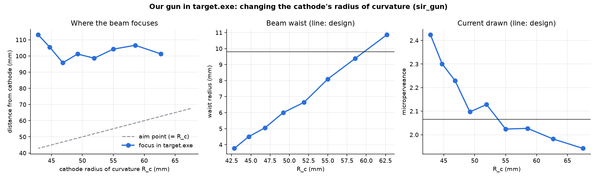

*Figure 8.4. CEERI gun, cathode radius of curvature (`sweep_rc_sir_gun.png`): aim point (dashed, = R_c) against the actual focus, waist, and microperveance.*

#### 8.7.2 Paper case 15 (10 kV, design P 1.01 µperv, r_w 2.00 mm, C 25; network angle 30.08°)

**Table 8.6. Anode sweep, case 15** (R_c 22.05 mm, R_a 8.73 mm, r_c 10.0 mm).

| Shift (mm) | d (mm) | µP PIERCE | Current (A) | vs design | µP 1/d² | µP L-B | Focus (mm) | Waist (mm) | Lost in gun |
|---|---|---|---|---|---|---|---|---|---|
| −4 | 9.32 | 3.329 | 3.329 | +229.6 % | 2.604 | 4.707 | 33.3 | 2.60 | **10/52** |
| −3 | 10.32 | 2.541 | 2.541 | +151.6 % | 2.124 | 3.375 | 34.8 | 1.87 | **5/52** |
| −2 | 11.32 | 1.982 | 1.982 | +96.2 % | 1.765 | 2.438 | 39.6 | 1.26 | **1/52** |
| −1 | 12.32 | 1.576 | 1.576 | +56.0 % | 1.490 | 1.766 | 41.7 | 0.72 | 0/52 |
| 0 | 13.32 | 1.275 | 1.275 | +26.2 % | 1.275 | 1.275 | 37.8 | 0.47 | 0/52 |
| +1 | 14.32 | 1.050 | 1.050 | +4.0 % | 1.103 | 0.912 | 35.0 | 0.35 | 0/52 |
| +2 | 15.32 | 0.879 | 0.879 | −13.0 % | 0.964 | 0.643 | 34.5 | 0.30 | 0/52 |
| +3 | 16.32 | 0.745 | 0.745 | −26.2 % | 0.849 | 0.441 | 33.5 | 0.35 | 0/52 |
| +4 | 17.32 | 0.640 | 0.640 | −36.6 % | 0.754 | 0.291 | 32.9 | 0.25 | 0/52 |
| +6 | 19.32 | 0.488 | 0.488 | −51.7 % | 0.606 | 0.101 | 32.6 | 0.26 | 0/52 |

(At 10 kV, V^1.5 = 10⁶, so current in A equals microperveance numerically.)

**Table 8.7. Cathode R_c sweep, case 15** (r_c 10.0 mm).

| Δθ (°) | θ_T (°) | R_cT = aim (mm) | R_c (mm) | R_a (mm) | d (mm) | Focus (mm) | Focus / aim | Waist (mm) | µP PIERCE | vs design | Lost in gun (where, mm) |
|---|---|---|---|---|---|---|---|---|---|---|---|
| −8 | 22.1 | 26.6 | 29.40 | 14.11 | 15.29 | 52.2 | 1.96 | 2.56 | 1.377 | +36.3 % | **7/51** (24.9, 24.9, 26.1, …) |
| −6 | 24.1 | 24.5 | 27.09 | 12.35 | 14.73 | 50.9 | 2.08 | 0.95 | 1.134 | +12.3 % | 0/51 |
| −4 | 26.1 | 22.7 | 25.14 | 10.92 | 14.22 | 47.2 | 2.08 | 0.63 | 1.154 | +14.3 % | 0/51 |
| −2 | 28.1 | 21.2 | 23.48 | 9.73 | 13.75 | 40.2 | 1.90 | 0.56 | 1.228 | +21.6 % | 1/52 (2.6) |
| 0 | 30.1 | 20.0 | 22.05 | 8.73 | 13.32 | 37.8 | 1.89 | 0.47 | 1.275 | +26.2 % | 0/52 |
| +2 | 32.1 | 18.8 | 20.81 | 7.89 | 12.92 | 37.1 | 1.97 | 0.38 | 1.417 | +40.3 % | 0/52 |
| +4 | 34.1 | 17.8 | 19.72 | 7.17 | 12.56 | 34.4 | 1.93 | 0.38 | 1.507 | +49.2 % | 0/53 |
| +6 | 36.1 | 17.0 | 18.76 | 6.55 | 12.22 | 33.7 | 1.98 | 0.34 | 1.623 | +60.7 % | 0/53 |
| +8 | 38.1 | 16.2 | 17.92 | 6.01 | 11.90 | 33.4 | 2.06 | 0.34 | 1.765 | +74.8 % | 2/53 (13.9, 14.0) |

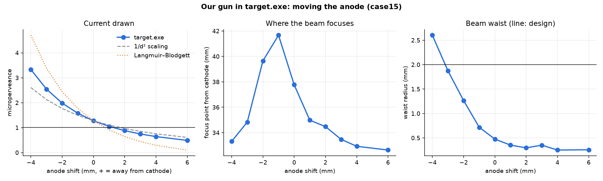

*Figure 8.5. Case 15 in PIERCE, anode shift (`sweep_anode_case15.png`).*

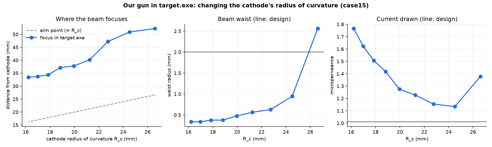

*Figure 8.6. Case 15, cathode radius of curvature (`sweep_rc_case15.png`).*

#### 8.7.3 Interpretation

1. **Current against spacing.** In all 18 shifted runs (two guns × nine non-zero shifts), the PIERCE perveance lies between the planar 1/d² scaling and the spherical Langmuir–Blodgett prediction, and closer to 1/d². L-B overstates the sensitivity: for case 15 at +6 mm it predicts 0.101 µperv where PIERCE gives 0.488. A plausible reason, which we have not tested, is that the shifted anode is no longer the concentric sphere that L-B assumes.
2. **The anode sets the current strongly and the waist with it.** On the CEERI gun, the design waist (9.8 mm) is reached between −3 and −4 mm (9.36–10.35 mm), but there the current is +36 % to +50 %. The design current is reached near 0 to +0.5 mm (Table 8.3), where the waist is about 6.2–6.6 mm. **One knob cannot meet both targets.** This is why the 2-D tuning of §9.2 adds the electrode angle.
3. **Aim point against focus.** Space charge pushes the real focus well beyond the cathode's centre of curvature: 1.62–2.64 × on the CEERI gun and 1.89–2.08 × on case 15. On case 15 the focus moves monotonically with R_c. On the CEERI gun it does not (95.8–113.1 mm with no trend), because the focus there is a shallow, broad minimum that the 6 mm envelope sampling resolves only coarsely (§8.2).
4. **A flatter cathode (larger R_c) gives a larger waist and less current.** On the CEERI gun the waist goes from 3.77 mm (R_cT 42.8 mm) to 10.86 mm (62.7 mm) and crosses the 9.8 mm design between R_cT 58.5 and 62.7 mm.
5. **Interception sets the limits.** Too flat a cathode puts the beam on the gun: 38/56 electrons on the CEERI gun at −8°, and 7/51 on case 15. On case 15, moving the anode 2–4 mm toward the cathode also causes hits (1–10 of 52).

### 8.8 Limits of the simulations

These are from `reports/SIMULATION.md` §7.

- The grid is 0.5 mm for the CEERI gun (0.1–0.5 mm for the 10 kV guns), and the envelope is sampled every 6 mm.
- Changing the emission settings DZ/DX from Vedant's (1.5, 1.0) to the supervisor's ratios (2.0, 0.6) moved Vedant's current from 155.3 A to 151.8 A. About 2 % of the simulator's answer therefore depends on settings we did not tune.
- PIERCE uses Child-law (space-charge-limited) emission, with no thermal velocities and no magnetic field.
- The 10 kV voltage for the literature guns is our choice: Table 2 gives no voltages.

---

## 9 Optimisation

### 9.1 NSGA-II over the exact-solver emulator (Design tab)

Setup (`reports/INTEGRATION_SUMMARY.md`; `src/moo/`):

- **Variables:** V, r_w, J_c at fixed I.
- **Objectives** (selectable): J_c, θ_T, V, z_ac, throw, |r_w − target|, |θ_T − target|.
- **Constraints:** solver-feasible; θ_T ≤ 66.5°; gap field V/z_ac ≤ E_max; −α < 7.9; θ_raw ≤ 56.44° (aperture defined); **deck-constructible by Vedant's electrode construction** (D12).
- **Search:** pymoo NSGA-II, population 100 × 500 generations = **50 000 evaluations per study**, emulator backend, seed 1. The knee is the design closest to the ideal point after normalisation.

**Table 9.1. Two studies.**

| | Shin 35 GHz EIK | CEERI 8 MW klystron |
|---|---|---|
| Fixed current | 0.5 A | 120 A |
| Objectives | J_c, θ_T, \|r_w − 0.2255\| | J_c, V, \|r_w − 9.8\| (throw 77.9 mm ± 10 %) |
| Wall time | 164 s | 189 s |
| Pareto designs | 100, all deck-constructible | 100, all deck-constructible |
| Knee (V, r_w, J_c) | 13.96 kV, 0.2405 mm, 4.14 A/cm² | 110.7 kV, 10.26 mm, 3.06 A/cm² |
| Knee θ_T / θ_raw | 16.43° / 14.83° | 45.32° / 40.05° |
| Knee R_c, z_ac, throw | 7.66, 4.65, 13.18 mm | 54.88, 29.96, 81.22 mm |
| If built and measured (1.046 θ_T ± 13.8 %) | 17.2° (14.8–19.6°) | 47.4° (40.8–54.0°) |
| Published design | 14 kV, 0.2255 mm, 5 A/cm²: θ_T 16.29° | 150 kV, 9.8 mm, 5 A/cm²: θ_T 32.16° |

Before D12 was added, **0 of 100** CEERI Pareto designs could be turned into a deck. With it, the CEERI front sits at θ_T 43.7–45.3°, where Vedant's 67.5° construction stops closing. The fronts are optima of the classical model, not of measured guns. Pareto designs were re-verified by the exact solver (G3). The knee decks are `reports/moo/*/egun_deck_*.txt`. **The knee designs were not simulated in PIERCE** (§13).

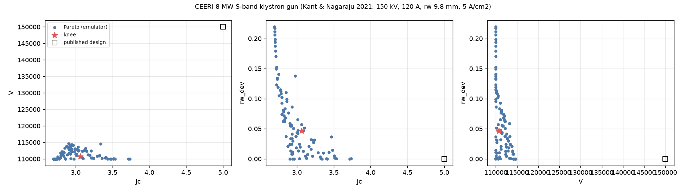

*Figure 9.1. NSGA-II Pareto front, CEERI study (`reports/moo/ceeri_klystron/pareto.png`). The Shin study is `reports/moo/shin_eik/pareto.png`.*

### 9.2 Simulation-in-the-loop tuning

| Knob(s) | Method | Gun | Runs | Result | Source |
|---|---|---|---|---|---|
| Focus-electrode angle ψ | Secant on ψ; target design current | CEERI, Vedant's construction | 3 (57.5°, 62.5°, 57.084°) | 120.19 A (+0.16 %); waist 6.40 mm (−34.7 %) | `tuned_psi.json` |
| ψ and anode shift | Newton, forward-difference Jacobian; targets current and waist; tolerance 0.5 % / 3 % | CEERI, Vedant's construction | 13 | best ψ 65.656°, anode +2.265 mm: 119.14 A (−0.72 %), waist 9.61 mm (−1.91 %). Flagged `converged: false` | `tuned_2d.json` |
| Anode shift | Secant; target design perveance; tolerance 1 % | Our gun, 5 guns | 3–8 each | within 1.3 % (Table 8.3) | `ourgun/summary.json` |
| Cathode R_c | Sweep only (not optimised) | Our gun, CEERI and case 15 | 9 each | Table 8.5, 8.7 | `sweeps/*.json` |

The 2-D Newton stopped short of its tolerance. Steps smaller than the 0.5 mm grid do not move any electrode point, so its last two steps gave identical results. This is the grid's resolution, not a solver failure (`reports/SIMULATION.md` §3).

---

## 10 Website and local launcher

### 10.1 The website (`web/`)

The site is static: no build step and no runtime network calls. It works from `file://` (`reports/DEPLOYMENT.md`). The model is exported as JSON and run in JavaScript. A deploy URL is not recorded in `README.md` ("not deployed yet"). The midsem report names `pencilgun.netlify.app` for the earlier Phase-2 site.

| Tab (id) | What it shows | Screenshot |
|---|---|---|
| **Predict** (`#predict`) | Inputs P, r_w, C; M1's θ with an uncertainty band; the gun drawn from θ; the geometry table; the **Tiwary–Basu card** (`#bfe-card`: focus electrode V = 0 and anode face V = V_a, angle 67.5° to the beam edge and 67.5° − θ to the axis, electrode tip, anode top, R_a by L-B with 14.665); comparison with the classical methods | `screens/predict_full.png`, `screens/predict_bfe_card.png`, `screens/predict_gun_svg.png` |
| **Design** (`#design`) | Vedant's four inputs (V, I, r_w, J_c) → complete gun by an in-browser port of his solver (emulated, verified); θ_T and θ_raw; choice of Vedant's straight electrode (angle ψ) or Tiwary–Basu curves; anode shift; download of the PIERCE deck (`target.exe`) or his original deck; NSGA-II Pareto front | `screens/design_full.png` |
| **Simulation** (`#sim`) | **New:** "Our gun in target.exe: move the anode, change the cathode": gun selector (CEERI 150 kV, case 15 at 10 kV), Anode shift / Cathode R_c toggle (`#sw-mode-anode`, `#sw-mode-rc`), a slider over the real runs, stats (µP, focus, waist, electrons hitting the gun), the trajectory plot with aim point and focus, and two charts. **New, local only:** "Run our gun in target.exe now" (`#live-card`). Earlier studies: run table, trajectories, ψ sweep, and what the two papers added | `screens/sim_full.png`, `screens/sim_sweep_anode.png`, `screens/sim_sweep_rc.png`, `screens/sim_sweep_anode_case15.png`, `screens/sim_sweep_rc_case15.png`, `screens/sim_live_card_local.png` |
| **Dataset** (`#dataset`) | All rows with tier and split filters, search, and provenance | `screens/dataset_full.png` |
| **Method** (`#method`) | Network diagram, why an ANN, ln C scaling, LM, the Jacobian checks, the physics, and the failed closure | `screens/method_full.png` |
| **About** (`#about`) | Limitations in full, what is solid, the source | `screens/about_full.png` |
| Results (hidden) | Benchmark tables and figures. The tab button is commented out in `web/index.html` ("too many graphs to explain"), and no panel was found in the live DOM, so no screenshot was taken | — |

A research banner on every page states: "This is a research result, not a design tool … median error on held-out guns is about 8 %".

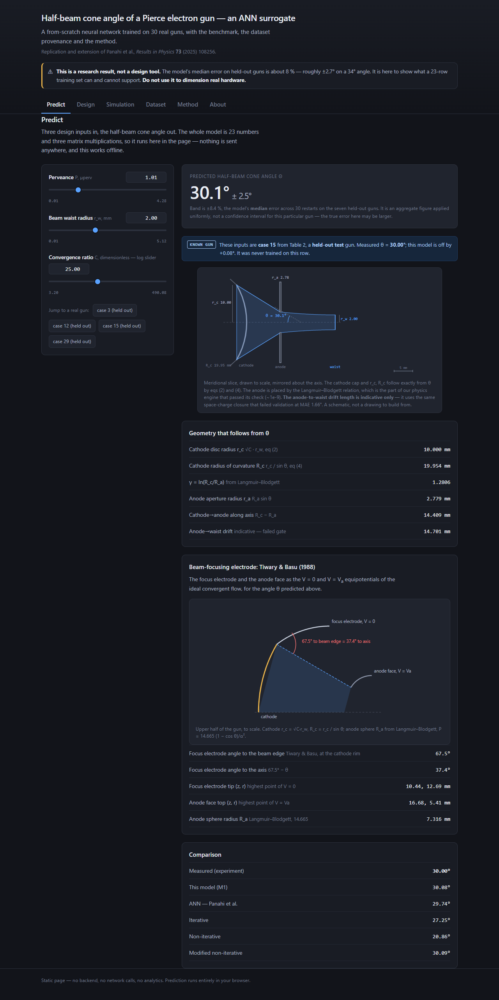

*Figure 10.1. Predict tab (full page).*

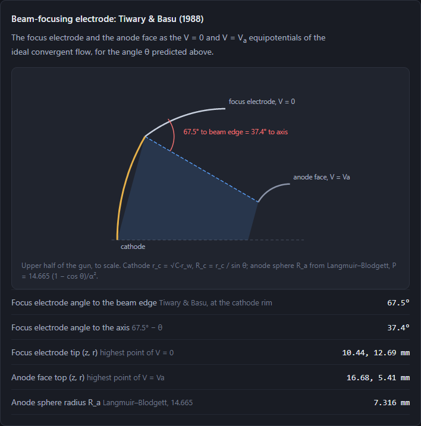

*Figure 10.2. Tiwary–Basu card on the Predict tab: focus electrode and anode equipotentials for the predicted θ.*

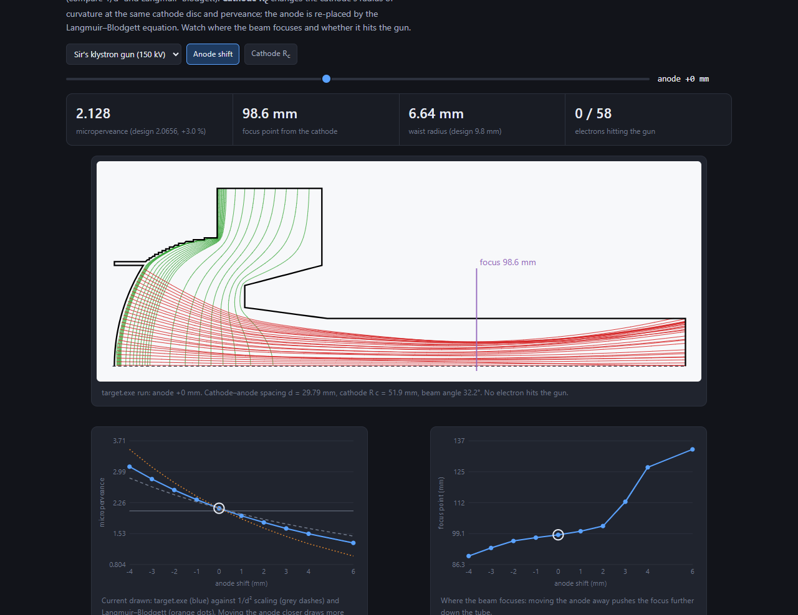

*Figure 10.3. Simulation tab, sweep section, CEERI gun, Anode-shift mode.*

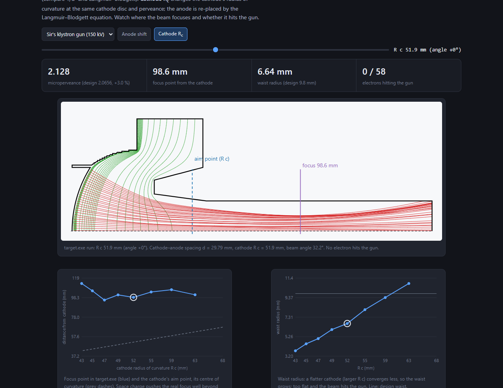

*Figure 10.4. Same section in Cathode-R_c mode at the network's angle (R_c 51.9 mm, focus 98.6 mm, waist 6.64 mm, 0/58 electrons hitting the gun).*

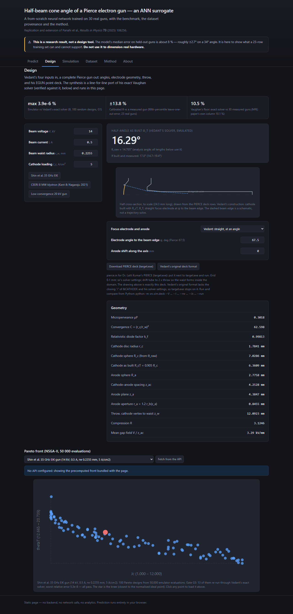

*Figure 10.5. Design tab.*

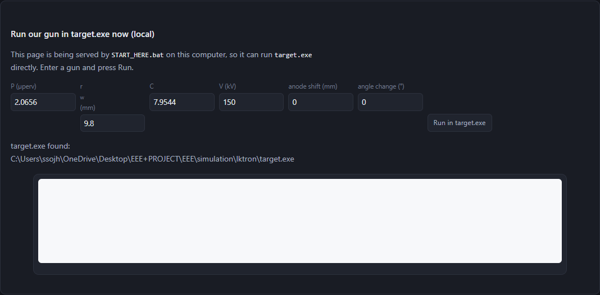

*Figure 10.6. The local-only live-run card when served by `serve_local.py` (status: target.exe found). It shows a local path, so do not use it in public material.*

Further screenshots: `screens/sim_full.png`, `screens/sim_sweep_anode_case15.png`, `screens/sim_sweep_rc_case15.png`, `screens/dataset_full.png`, `screens/method_full.png`, `screens/about_full.png`.

### 10.2 Local launcher for the supervisor

| File | Role |
|---|---|
| `START_HERE.bat` | Double-click. Finds Python (3.10+). On first run it creates `.venv` and installs `requirements-local.txt` (numpy, pandas, mpmath), which needs internet once. Then it runs `serve_local.py` |
| `serve_local.py` | Serves `web/` at **http://127.0.0.1:8765** (localhost only) and opens `#sim`. It finds `target.exe` via `--exe`, `PIERCE_EXE`, `simulation/lktron/`, the project folder, or the folder above. `/api/status` and `/api/simulate` build our gun for typed P, r_w, C, V, anode shift and angle change, then run **the supervisor's own target.exe** (one run at a time, under a minute) |
| Output | Every run's files (`pierce.in`, `pierce.log`, `pierce.plt`, …) are kept in `simulation/runs/local/<date_time_inputs>/` so his `pierce_plotter.py` and `new3d.py` work on them unchanged |
| `README_FOR_SIR.md` | Steps and terminal commands |

---

## 11 Demo videos

Location: `C:\Users\ssojh\OneDrive\Desktop\EEE+PROJECT\demo_videos\`. They are built by `demo/make_videos.py` from recorded real runs, with narration and captions.

| File | Content |
|---|---|
| `demo1_our_code_and_papers.mp4` | Our code: training M1, the Stage-2 evaluation, the website, then the two focus-electrode papers |
| `demo2_our_code_plus_vedant.mp4` | Vedant's solver on its own, our emulator of it, Gate G1, his deck writer, the Design tab |
| `demo3_all_simulations_target_exe.mp4` | Every simulation in PIERCE (`target.exe`), animated from its own output files, the tuned gun, the supervisor's plotter, the Simulation tab |
| `demoA_website_tiwary_basu.mp4` | The website after adding Tiwary & Basu (1988): the paper's method checked on its three guns, and the focus electrode and its angle from the inputs |
| `demoB_our_code_on_target_exe.mp4` | How our code drives `target.exe`: what it is, the deck fixes, every output |
| `demoC_website_gun_and_tiwary_basu.mp4` | Predict tab: the Pierce gun plus the Tiwary–Basu focus electrode and its angle |
| `demoD_our_gun_in_target_exe.mp4` | Our gun (network angle + Vaughan synthesis + Tiwary–Basu electrode) simulated in `target.exe` |
| `demoC1_complete_website.mp4` | *(in production)* The complete website: our gun, the Tiwary–Basu electrode, simulations, data, results |
| `demoD1_our_gun_target_exe_sweeps.mp4` | *(in production)* Our gun in `target.exe`, the anode-shift and cathode-R_c studies, and the live run |

---

## 12 Limitations and negative results

1. **The published 3.74 % was not reproduced.** Our median is 8.33 % and the selected model gets 7.93 %. The data and metrics are verified to the digit, so the gap is in an unstated detail of the method or in run selection, and we cannot tell which.
2. **There are 23 training rows for 23 parameters.** The test set has 7 guns. The bootstrap 90 % interval of M1's test MRE is 4.7–11.4 %.
3. **Synthetic data hurt.** M3 scored 9.77 % against M1's 7.93 %. The generator was validated against the iterative method (2.80 %), and that method is itself about 10 % from measurement (10.48 % for the generator against measured θ over C ≥ 8).
4. **The strict physics gate is still failed** (1.66° / 5.75 %), and the C < 8 corner has no synthetic support.
5. **A wrong constant was used in Tier B v1** (29.33 for 14.665, D10). The Method tab's text and the old Predict-tab anode sketch (`web/js/physics.js`) still show 29.33. This is flagged in D10 and not yet corrected.
6. **The calibrated closure's 2.88 % is not claimed.** It depends on ln r_w, which is physically unjustified (D11).
7. **The second output R_c is not independent** of θ (D3). Its definition is still an open question for the supervisor.
8. **Every synthesised gun over-draws current in PIERCE**, by 3–56 %. The two low-convergence guns (26, 29) fail outright.
9. **Simulated waists are 32–88 % smaller than designed** in every gun that formed a waist, tuned or not. Matching current with the anode alone leaves the waist off.
10. **Vaughan's throw is optimistic** on the CEERI gun in every run.
11. **The tuning resolution is limited by the grid.** Sub-cell anode shifts do nothing (§8.6). The 2-D Newton is flagged `converged: false`.
12. **Case 3 is missing from the anode-tuning record** (§8.6).
13. **Tiwary–Basu's planar map drops axisymmetric terms of 53–63 % rms.** Alone, it gives −14.5 % current on the CEERI gun.
14. **Sharma et al. (2001) aperture synthesis is not implemented.** Designs with θ_raw > 56.44° get no deck.
15. **About 2 % of PIERCE's current depends on emission settings** we did not tune. There are no thermal velocities and no magnetic field.
16. **Only one gun (CEERI) has a trusted reference deck.** The literature guns were run at an assumed 10 kV.
17. **The NSGA-II knee designs were not simulated in PIERCE.**
18. **Vaughan 1981, Tiwary & Basu 1987, Yang 2006 and Frost 1962 were not retrieved directly.** Their cases come through Panahi et al.

---

## 13 Future work

- Simulate the NSGA-II knee designs in PIERCE and add PIERCE-based objectives (current error, waist error, interception) to the search.
- Make the tuning grid-aware: refine the grid near the anode, or tune in whole grid steps. Tune the cathode R_c together with ψ and the anode.
- Re-run the case 3 anode tuning, and investigate why cases 26 and 29 intercept (electrode cut-off, low θ).
- Obtain Sharma et al. (2001) to replace the 1.2 aperture factor, and the original Vaughan, Tiwary–Basu (1987) and Yang (2006) papers to fix the aperture-lens term and open C < 8.
- Add real guns beyond Table 2: the midsem report lists 71 datapoints from four papers in progress.
- Correct the 29.33 constant in the website's Method text and in `web/js/physics.js`.
- Extend to the magnetic focusing stage (S2) using the simulated waist and throw.

---

## 14 Conclusion

A 23-parameter network, trained from scratch on 23 real guns, predicts the half-beam cone angle of a convergent Pierce gun to 7.93 % on seven held-out guns (median 8.33 % over restarts). That is about the level of the best classical method and in microseconds, but it is not the 3.74 % published for the same network. Building the gun around that angle with Vaughan's equations, solved exactly, and a Tiwary–Basu focus electrode gives a complete deck for the supervisor's PIERCE code.

The simulation shows what the equations miss. The guns draw 3–56 % too much current, waists come out smaller than designed, and low-convergence guns intercept. A few simulator-in-the-loop runs on the anode position bring the perveance within 1.3 % on five guns. The electrode angle plus the anode bring the 150 kV CEERI gun to −0.7 % current and −1.9 % waist.

The new sweeps quantify the levers. The current follows a law between planar 1/d² and Langmuir–Blodgett. The real focus is 1.6–2.6 times the cathode's geometric aim point. The cathode curvature trades waist against current, within limits set by interception. The ANN makes the search fast, and the field simulation decides the final geometry.

---

## References

1. R. Panahi, S.A.H. Feghhi, Sh. Sanaye Hajari, M. Khorsandi, "Determination of the Half-Beam cone angle for Pierce electron gun design using an artificial neural network," *Results in Physics*, vol. 73, 108256, 2025. doi:10.1016/j.rinp.2025.108256.
2. J.R.M. Vaughan, "Synthesis of the Pierce gun," *IEEE Trans. Electron Devices*, vol. ED-28, no. 1, pp. 37–41, 1981.
3. U. Tiwary, B.N. Basu, "Noniterative synthesis of convergent Pierce electron guns by the conformal mapping of electrode shapes using logarithmic transformation," *IEEE Trans. Electron Devices*, vol. 35, no. 7, pp. 1184–1187, 1988.
4. U. Tiwary, B. Basu, "Noniterative method for the synthesis of convergent Pierce electron guns," *IEEE Trans. Electron Devices*, vol. 34, no. 5, pp. 1218–1222, 1987.
5. C. Yang, B. Jia, Z. Zhu, "Improved noniterative method for the synthesis of convergent Pierce electron guns," *IEEE Trans. Electron Devices*, vol. 53, no. 11, pp. 2849–2852, 2006.
6. C. Yang, B. Jia, Z. Zhu, "Improvement in the synthesis method of the Pierce electron gun," *High Power Laser and Particle Beams*, vol. 18, no. 9, 2006.
7. Liao et al., 2003 (starting angle; cited via [6]; full reference not in the repository).
8. Greenwood, Zhang, Lau et al., *Physics of Plasmas*, vol. 23, 072101, 2016.
9. I. Langmuir, K.B. Blodgett, "Currents limited by space charge between concentric spheres," *Physical Review*, vol. 24, pp. 49–59, 1924.
10. R. Frost, O. Purl, H. Johnson, "Electron guns for forming solid beams of high perveance and high convergence," *Proc. IRE*, vol. 50, no. 8, pp. 1800–1807, 1962.
11. H. Gao, G. Ding, X. Zhou et al., "Numerical study for the effect of angle between inner wall of Wehnelt electrode and its axis on beam dynamics in a thermionic electron gun," *AIP Advances*, vol. 15, 015030, 2025. doi:10.1063/5.0240111.
12. J.R. Pierce, *Theory and Design of Electron Beams*, Van Nostrand, 1954.
13. D. Nguyen, B. Widrow, "Improving the learning speed of 2-layer neural networks by choosing initial values of the adaptive weights," Proc. IJCNN, vol. 3, pp. 21–26, 1990.
14. Kant, Nagaraju, *IJAMT*, vol. 6, no. 2, 2021 (8 MW S-band CEERI klystron gun).
15. Ardebili et al., *Results in Engineering*, 2025 (Table 1, nine guns).
16. R.K. Sharma, A.K. Sinha, S.N. Joshi, "An improved method for the synthesis of anode aperture for Pierce guns," *IEEE Trans. Electron Devices*, vol. 48, no. 2, pp. 395–397, 2001 (not implemented).
17. L. Kumar, LKTRON PIERCE (`target.exe`), version 29 Oct 2026, with `pierce_plotter.py` and `new3d.py` (unpublished software, used with permission).

---

## Acknowledgements

We thank **Dr. Lalit Kumar** for supervising this project, for setting its direction, and for the use of his LKTRON PIERCE simulator (`target.exe`), its reference CEERI deck and his plotting scripts. The program is his copyrighted work and is used here, not owned.

We thank **Vedant**, a senior student, for his exact implementation of Vaughan's (1981) synthesis with the Yang–Jia–Zhu, Liao and Greenwood amendments, his focus-electrode construction and his EGUN point-deck writer (`src/physics/vendor/pierce_gun_design_fixed.py`). It is included unmodified with his permission, and it is the exact solver behind the synthesis, the emulator, Tier B2, Gate G1/G3 and every deck simulated in this report.

We acknowledge the authors of the reference ANN study (Panahi, Feghhi, Sanaye Hajari and Khorsandi) and of the classical synthesis methods this work builds on. We also thank the Department of EEE, BITS Pilani Hyderabad Campus.

---

## Appendix A: How to reproduce

Python 3.12 is used (3.10+ for the launcher). Node 20 is needed for the JS parity test. `target.exe` must be at `simulation/lktron/target.exe` for any simulation.

```bash
pip install -r requirements.txt

# Dataset and ANN
python src/data/build_tier_a.py            # Tier A from the verbatim Table-2 block
python src/data/build_master.py
python -m src.ann.train --model m1       --export models/model_m1.json
python -m src.ann.train --model m1-multi --export models/model_m1_multi.json
python -m src.ann.experiments              # BENCHMARK.md measurements
python -m src.ann.figures                  # figures 3-7

# Exact synthesis, synthetic v2, gates, optimisation
python -m src.physics.gate_g1              # G1
python -m src.data.synth_v2                # Tier B2 (1015 rows)
python -m src.ann.stage2                   # ANN-E, Stage 2, one-time 7-gun evaluation
python -m src.moo.run shin_eik ceeri_klystron
python -m src.moo.verify                   # G3
python -m src.moo.deck --study shin_eik    # EGUN deck of the knee
python -m src.export.design_data           # Design tab data

# PIERCE (target.exe)
python demo/run_reference.py               # supervisor's deck through our driver: 121.7416 A
python -m src.sim.deck --V 150000 --I 120 --rw 9.8 --Jc 5 --run
python -m src.sim.experiments              # all CEERI variants
python -m src.sim.experiments --tune       # psi tuning and 2-D tuning
python -m src.sim.report                   # figures, SIMULATION_RESULTS.md, web data
python -m src.sim.ourgun --tune            # our gun on 8 guns + anode tuning
python -m src.sim.sweeps                   # sweeps, CEERI gun
python -m src.sim.sweeps --gun case15      # sweeps, case 15
python -m src.sim.sweeps --gun case15 --report-only   # re-plot from saved JSON, no simulation

# Tests
pytest

# Website
#   static: open web/index.html
#   with live target.exe: double-click START_HERE.bat  (or: python serve_local.py)
```

## Appendix B: File map

| Path | Content |
|---|---|
| `data/raw/` | Papers (Panahi, Tiwary–Basu 1988 (git-ignored), Gao), original sheet |
| `data/processed/` | `dataset_literature.csv` (Tier A), `dataset_master.csv`, `dataset_tier_b.csv` (v1), `dataset_synthetic_v2.csv` (B2) |
| `data/SOURCES.md` | Provenance ledger |
| `src/ann/` | Network, Jacobian, LM, scaling, transforms, metrics, training, experiments, figures, Stage 2 |
| `src/physics/` | `lb.py` (L-B constants), `closure.py` (emulator), `kf.py`, `bfe.py` (Tiwary–Basu), `vaughan_adapter.py`, `vendor/pierce_gun_design_fixed.py` (Vedant's solver, unmodified), `probe_closure.py`, `gate_g1.py` |
| `src/data/` | Tier A / master / synthetic builders |
| `src/moo/` | NSGA-II problem, run, verify (G3), deck |
| `src/sim/` | `lktron.py` (driver), `deck.py`, `experiments.py`, `report.py`, `ourgun.py`, `sweeps.py` |
| `src/export/` | Weights and site data |
| `models/` | `model_m1.json`, `model_m1_multi.json`, `kf_table.json` |
| `reports/` | `BENCHMARK.md`, `DECISIONS.md` (D1–D14), `VALIDATION_table2.md`, `INTEGRATION_*.md`, `SIMULATION*.md`, `DEPLOYMENT.md`, `gates/G1.json`, `moo/`, `simulation/`, `figures/` |
| `reports/simulation/ourgun/summary.json` | Our gun on 8 guns + tuning |
| `reports/simulation/sweeps/{sir_gun,case15}.json` | New sweeps |
| `web/` | Static site; `web/data/sweeps.js` generated by `src/sim/sweeps.py` |
| `serve_local.py`, `START_HERE.bat`, `README_FOR_SIR.md` | Local launcher |
| `demo/` | Video tooling (`make_videos.py`, `videokit.py`, `anim.py`, `capture.py`, `paper1_check.py`, `run_reference.py`) |
| `simulation/lktron/` | `target.exe` (supervisor's, git-ignored), `pierce_plotter.py`, `new3d.py`, `reference_ceeri/` |
| `docs/ivac2027/` | This report, `ABSTRACT.md`, `POSTER.md`, `screens/` |

## Appendix C: Figure list

| File | Content |
|---|---|
| `reports/figures/fig3_regression_train.png` | M1 predicted vs measured θ, training guns |
| `reports/figures/fig3_regression_test.png` | Same, 7 test guns |
| `reports/figures/fig4_mse_vs_epochs.png` | Training / CV MSE against epochs |
| `reports/figures/fig5_method_comparison.png` | ANN vs classical methods |
| `reports/figures/fig6_percentage_error.png` | Percentage error per gun |
| `reports/figures/fig7_restart_histogram.png` | Test MRE over 30 restarts |
| `reports/figures/tier_overlap.png` | Synthetic coverage vs real guns |
| `reports/figures/tiwary_basu_fig2.png` | Tiwary–Basu Fig. 2 recomputed |
| `reports/figures/sim_trajectories.png` | PIERCE trajectories, five CEERI decks |
| `reports/figures/sim_psi_sweep.png` | Current and waist vs ψ |
| `reports/figures/sweep_anode_sir_gun.png` | **New:** anode sweep, CEERI |
| `reports/figures/sweep_rc_sir_gun.png` | **New:** R_c sweep, CEERI |
| `reports/figures/sweep_anode_case15.png` | **New:** anode sweep, case 15 |
| `reports/figures/sweep_rc_case15.png` | **New:** R_c sweep, case 15 |
| `reports/moo/shin_eik/pareto.png`, `reports/moo/ceeri_klystron/pareto.png` | NSGA-II fronts |
| `docs/ivac2027/screens/*.png` | 13 website screenshots (§10) |
